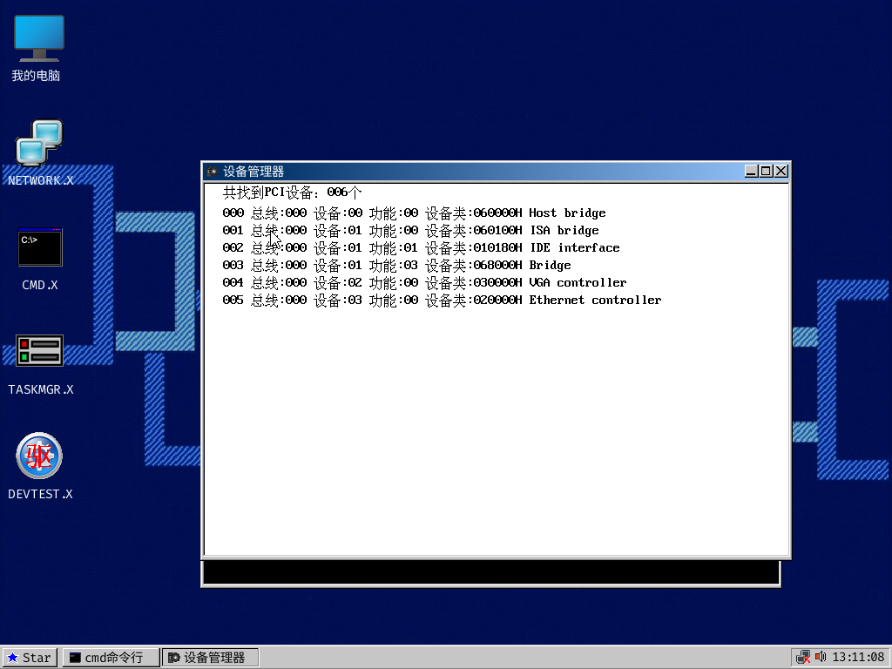

# 原版 .X 二进制兼容检查（2026-10-28）

当前 OpenIceStarOS 集成镜像可以加载并运行原 IceStarOS 的 `.X` 程序。
本次通过原始文件哈希、加载器差分及真实 QEMU 运行交叉验证；没有修改生产代码或原版程序。

## 实际运行

```sh
python3 rewrite/tools/boot_smoke.py \
  rewrite/build/OpenIceStarOS_c_apps.vhd \
  --cursor-check --memory-check --task-check
```

命令退出码为 0。测试通过模拟 PS/2 输入打开 CMD、运行 `cpuid`，然后执行
`cd icestar` 和 `devmgr.x`。原版设备管理器成功创建 680×460 窗口；运行截图显示
6 个 PCI 设备。测试检查了边框处的缩放光标、窗口内部的普通光标、关闭后的窗口删除，
以及返回 CMD 后的目录命令。边框测试仅检查鼠标悬停和光标，不表示测试了拖动缩放。

`/ICESTAR/DEVMGR.X` 为原版 33,482 字节文件，镜像中的文件与原盘逐字节相同，
SHA-256 均为：

```text
79a34ce65e16481b787a0396ec076ed94af96d2c493d8c46a8ca408f9be6ab18
```

同时通过 128 MiB RAM/59 个活动堆头检查、真实 TSS 任务切换检查，以及全部
358 个已安装 C 内核替换区间与来宾内存的比较。



## 格式与加载行为

`kernel/x_loader.c` 保留原版的两种应用头类型 `0x0a` 和 `0x50`、入口偏移、
32 位绝对地址重定位、BSS/栈清零和任务创建约定。完整路径加载支持两种类型；
底层相对目录索引加载入口只接受 `0x0a`，这是原版行为。

```sh
make -C rewrite test-x-loader
```

本次退出码为 0：430 个场景、1,290 次原版 x86/普通 C/固定地址 C 对比执行。
其中包括原盘所有 35 个 `0x0a`/`0x50` 程序路径在对齐和非对齐基址的加载启动约定比较，
涵盖重定位、分配、任务参数和重复启动路径。该差分测试在分配、文件系统、任务创建及
界面调用边界使用确定性回调，因此不等于逐个程序的端到端功能测试。

## 镜像文件审计

按清单从原盘及当前镜像分别读取全部 39 个 `.X`/`.DX` 程序路径，原盘文件哈希
均与清单一致。当前镜像有 30 个路径逐字节保留原程序，其中 26 个是 `.X`，
4 个是 `.DX`。另外 9 个路径为 5 个 C 重编译应用、部分恢复的内核、两个仅修改
显示品牌的 CMD 副本和 TASKBAR。原版文件仍然保留不代表它们已经逐一运行验证。

本次运行使用 QEMU 磁盘快照；测试前后原盘及生产镜像哈希一致。生产镜像 SHA-256：

```text
620c776e829a755aa9ad01680bf101d2f305dbf9f5bcefd8b5ea5d838e1388b7
```

证据位于 [`evidence/2026-10-28-x-compatibility`](../evidence/2026-10-28-x-compatibility/)：

- `disk-audit.json`：每个原始及镜像程序文件的哈希和比较结果。
- `loader-summary.json`、`loader-test.log`：加载器差分范围及结果。
- `qemu-boot.log`、`original-devmgr.json`、`cursor-execution.json`、`cmd-input.json`：实际运行检查。
- `original-devmgr.png`：直接来自 QEMU monitor 的实际运行截图。
- `sha256.json`：上述证据文件的哈希。

## 结论范围

已确认当前构建兼容原版 `.X` 格式，并实际运行了未经修改的原版 DEVMGR。
本次没有逐个验证所有应用功能、其他版本或第三方 `.X`，也没有验证所有驱动及真实硬件。
扩展名相同但格式/API 不同的文件不在结论范围内；`.DX` 驱动有单独的加载路径。
完整 OS 源码恢复仍未完成，当前运行继续依赖尚未恢复的原版逻辑和资源。
